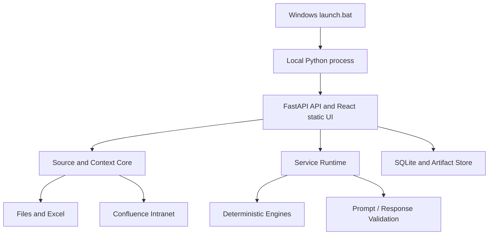

# Context Workbench — Product and Implementation Plan

**Status:** Draft v0.1  
**Date:** 22 October 2026  
**Audience:** Internal colleagues using their own Windows work PCs  
**Owner:** Product/development team (to be assigned)

## 1. Product vision

Build a local, browser-based workbench that helps nontechnical users:

1. Connect to permitted information sources such as local files, Excel workbooks, and intranet Confluence pages.
2. Select specific files, sheets, pages, and eventually document sections; combine and save these selections as reusable **Context Collections**.
3. Run predefined **Services** against those collections to produce useful outcomes, including synthesized knowledge bases, Excel transformations, and dashboards.
4. Use a company-approved AI chatbot through an explicit **copy prompt / paste response** loop when a service benefits from AI; otherwise execute deterministic operations locally.
5. Save recipes, run history, and resulting artifacts for reuse.

**Design principle:** The app is an information and analytics workbench, not an AI chatbot or a replacement for existing corporate tools. AI proposes or synthesizes where useful; local code remains responsible for deterministic data processing and validation.

## 2. Decisions already agreed

| Area | Decision |
| --- | --- |
| Target users | Nontechnical colleagues; each runs their own installation |
| Execution | User double-clicks a Windows `.bat` launcher on their work PC |
| Existing prerequisite | Each user has an available Python environment; launcher validates suitability |
| UI | Browser-based local app; React with TypeScript/JavaScript, HTML, and CSS is acceptable |
| Backend | Python; FastAPI is the proposed implementation framework |
| Hosting | Local-only process bound to `127.0.0.1`, not a shared server |
| Persistence | SQLite for metadata; files/artifacts stored in a per-user application-data directory |
| AI integration | No direct chatbot API assumed; user manually copies prompts and pastes responses |
| Excel complexity | Ordinary tabular sheets, but headers may begin below row 1 |
| Transformations | Deterministic engine and manual builder first; AI-designed recipes optional |
| Service model | Curated services used by colleagues; extensible interfaces maintained by developers |

**Clarification:** React uses JavaScript or TypeScript; Java is not required for the proposed UI.

## 3. Goals and non-goals

### Goals

- A discoverable UI that guides colleagues through source selection, service configuration, and output generation.
- Reusable Context Collections that can be reopened and refreshed.
- Clear provenance: source identity, source version/fingerprint, selected location, and run-time snapshot.
- Safe, inspectable, repeatable data transformations.
- A standard service framework so new services do not require redesigning the app.
- Reasonable operation without administrator privileges or a permanent central server, subject to IT rules.

### Out of scope for initial release

- Automated access to or control of the corporate AI chatbot.
- Multi-user collaboration, centralized accounts, or synchronization of user databases.
- Vector database, embeddings, or autonomous AI agents.
- Running arbitrary Python/JavaScript supplied by a pasted AI response.
- Complicated Excel layouts such as nested/merged multilevel headers or scattered mini-tables.
- A general-purpose enterprise ETL/orchestration platform.
- A service-authoring UI for end users.

## 4. Product areas and navigation

| Area | Purpose | Key screens |
| --- | --- | --- |
| **Sources** | Register and inspect available information | Source list, Add Source, Sheet/Page Preview, Source Settings |
| **My Contexts** | Compose reusable selections | Collection Library, Collection Editor, Context Export Preview |
| **Services** | Browse and launch predefined workflows | Service Catalog, Service Configuration |
| **Runs** | Execute, inspect, revisit prior workflows | Prompt/Response Workspace, Results, Run History |
| **Recipes & Artifacts** | Reuse deterministic workflows and outputs | Saved Transformations, Generated Knowledge Bases, Dashboards |
| **Settings** | Configure local paths, connectors, and preferences | Environment Check, Confluence Connection, Data Handling |

**Two entry points:** A user can start from a Context Collection and choose a service, or start from a service and then choose sources.

## 5. Core domain concepts

### 5.1 Source

An identified origin of information, such as a local PDF path, Excel workbook path, CSV file, or Confluence page ID/URL. The source record stores metadata and connection settings, not necessarily a permanent copy of all content.

### 5.2 Source Selection

The specific portion selected from a source: an Excel sheet, optional column subset, a Confluence page, or eventually a document section. Selection configuration includes parsing rules.

For Excel, store at least:

- Workbook source ID and sheet name.
- **Header row as a 1-based Excel row number**, shown in the UI.
- Optional selected columns and data-preview settings.
- Detected column names/types and any user corrections.

When passing the row to pandas, convert to its zero-based `header` parameter (`pandas_header = excel_header_row - 1`).

### 5.3 Context Collection

A named, reusable set of Source Selections, optionally with order, description, and inclusion/exclusion rules. It stores **references and configuration** so sources can be refreshed.

### 5.4 Context Snapshot

The resolved content/metadata actually used in one run. Each snapshot records source IDs, locations, retrieval time, hashes or versions, and export manifest. A collection may point to changing sources; a snapshot provides reproducibility.

### 5.5 Service Definition

Developer-maintained configuration/implementation describing accepted inputs, user settings, operation mode, prompt templates if needed, validators, and output artifacts.

Three modes:

1. **Deterministic:** local operations only.
2. **AI-assisted:** AI proposes a plan; local code validates/executes it.
3. **AI-dependent:** AI synthesizes output; local code validates and packages it.

### 5.6 Run and Artifact

A Run captures service configuration, input snapshot, prompts, pasted responses, validation status, errors, timestamps, and resulting artifact references. Artifacts are outputs such as `.xlsx`, `.csv`, Markdown, HTML dashboard bundles, or PDF in a later phase.

### 5.7 Transformation Recipe

A versioned, declarative sequence of named transformation operations with parameters, input roles, and output rules. The same recipe can be built manually or proposed by AI. Recipes can be rerun on refreshed sources after schema validation.

## 6. Core user workflows

### 6.1 Add and configure a spreadsheet source

1. Browse to a local workbook.
2. Select one or more sheets.
3. Preview the first several physical worksheet rows with Excel row numbers.
4. Auto-suggest a header row; allow manual override (e.g., row 5).
5. Show detected columns, types, null counts, and representative **approved** sample values.
6. Confirm and save the selection configuration.

**Acceptance:** Reopening the selection uses the saved sheet and header row. If columns change, the UI reports schema drift rather than silently misinterpreting data.

### 6.2 Build a Context Collection

1. Create a named collection.
2. Add configured file/sheet/page selections from the Source Library.
3. Reorder, remove, or selectively include items.
4. Preview source count, estimated prompt size, source identifiers, and any warnings.
5. Save. Later reopen or refresh individual selections.

**Acceptance:** A collection survives app restarts and reports missing/inaccessible/changed sources.

### 6.3 Run an AI-dependent service

1. Choose a collection and a service.
2. Set service-specific options.
3. Resolve a source snapshot; assemble an attributable context pack.
4. Preview the information leaving the PC; redact/exclude content as needed.
5. Generate and copy the prompt; user submits it to an approved corporate AI chatbot.
6. User pastes the AI response into the app.
7. Validate output structure and references; when invalid, show actionable errors and optionally generate a corrective follow-up prompt.
8. Produce an artifact; save it with the run history.

**Acceptance:** The user can finish the workflow without an AI API key or programmatic access to the chatbot.

### 6.4 Run a deterministic service

1. Choose configured dataset selections.
2. Build or load an operation recipe in the UI.
3. Validate inputs and preview intermediate or final data.
4. Run locally; generate output file.
5. Save the recipe and run record. Later rebind it to updated files and rerun.

**Acceptance:** Existing valid recipes work offline, without chatbot interaction.

## 7. Initial services

### 7.1 Synthesized Knowledge Base (AI-dependent)

**Inputs:** Text-bearing local documents and Confluence pages; selected Excel metadata/content where sensible.

**Controls:** Target audience, level of detail, topics, desired structure, citation requirements, contradiction/knowledge-gap detection.

**Prompt builder:** Packages selected content with explicit source IDs and page/section anchors. Requires claims to reference source anchors and asks the AI to distinguish facts, inference, and unsupported claims.

**Response contract:** Structured Markdown or a JSON document model containing sections, claims, citations, and open questions.

**Output:** Navigable Markdown/HTML knowledge base with clickable citations when source links are available; export formats can expand later.

**Validation:** Check that referenced IDs and locations exist. Semantic verification that a source actually proves a claim is **not guaranteed**; unresolved or suspect claims require review.

### 7.2 Data Transformation Studio (deterministic first)

**Inputs:** One or more configured Excel sheets or CSV datasets. Default initial scope assumes each selection is a rectangular table after the configured header row.

**Manual UI:** A stepwise pipeline builder with a catalog of supported operations; clicking a step exposes field mappings/parameters. Show sample data and intermediate row counts.

**Initial operations:**

| Operation | Example | Validation |
| --- | --- | --- |
| Select / rename columns | Keep `Date`, `Amount`; rename `Amt` | Column existence, duplicate names |
| Filter / sort | `Region == 'Luzon'` | Known fields, valid comparison types |
| Append | Stack January and February | Schema compatibility |
| Join / lookup | Transactions to Product Master | Keys, cardinality, unmatched rows, row multiplication |
| Deduplicate | By `Transaction_ID` | Key existence and duplicate count |
| Convert types | Text to date or decimal | Failed conversions and null impact |
| Derived columns | `Revenue = Quantity * Price` | Constrained formula operators/fields |
| Group/aggregate | Revenue sum by region | Supported aggregates and types |
| Pivot / unpivot | Category columns to rows | Uniqueness and output shape |

**Execution:** Python/pandas functions interpret validated declarative operations; no `eval` or arbitrary Python from pasted answers.

**Outputs:** Excel and CSV, accompanied by a run summary including input fingerprints, operations, row counts, warnings, and output location.

**Optional AI mode:** Export **schema and approved samples**, plus a user-written goal, to the chatbot. The pasted response must be a recipe in the same validated operation schema used by the manual builder. The user can inspect/edit steps before execution.

**Reuse:** Store input roles, expected columns/types, operation sequence, and output definition. On rerun, users can substitute new monthly workbooks and resolve schema drift.

**Acceptance:** A colleague can choose three workbooks, set a non-first-row header for one sheet, join/filter/aggregate data, preview diagnostics, save an `.xlsx`, and rerun the recipe on updated workbooks without AI.

### 7.3 Dashboard Builder (deterministic foundation, optionally AI-assisted)

**Inputs:** Configured Excel/CSV datasets, possibly outputs from Transformation Studio.

**Manual design:** Select metrics/dimensions, filters, chart types, and basic layout; drag-and-drop layout is a later enhancement if needed.

**Optional AI mode:** Pass dataset schema, metric definitions, and approved samples to request a structured dashboard specification. Local code validates that referenced fields and aggregations exist, calculates all values, and renders charts.

**Outputs:** Saved interactive local dashboard and, later, an HTML/PDF export.

**Acceptance:** All displayed numbers originate from local data computations, not from values invented in an AI response. Reopening a dashboard can refresh its source selection.

## 8. Proposed architecture



### Frontend

- React with TypeScript, HTML/CSS; a maintained component system may be selected at implementation time.
- UI modules: Source browser, sheet preview, collection editor, service forms, transformation pipeline, prompt/response workspace, artifact preview, run history.
- Browser makes HTTP requests to a local FastAPI backend. Avoid holding large datasets permanently in browser state.
- Frontend compiled to static assets and served by Python in normal use; end users do not require Node.js to launch the app.

### Backend

- Python FastAPI for endpoints, local lifecycle, validation, and output streaming.
- pandas for tabular transformations and Excel reading/writing adapters as appropriate.
- SQLite for structured metadata; file content/results in a per-user storage area.
- A thin `Service` contract, for example `input_requirements`, `configure`, `prepare`, `validate`, `execute_or_finalize`, `artifacts`.
- Source adapters return normalized metadata/content while retaining source-native references.

### Suggested repository layout

```text
context-workbench/
  launch.bat
  backend/
    app/main.py
    app/api/
    app/core/            # sources, collections, snapshots, runs
    app/connectors/      # local files, Excel/CSV, Confluence
    app/services/        # knowledge_base, transformation, dashboard
    app/transformations/ # operation registry, executor, validators
    app/storage/         # SQLite models, migrations, artifacts
    tests/
    requirements.lock    # or equivalent pinned dependency set
  frontend/
    src/
    package.json
    ...
  docs/
```

Production per-user data should live in a user-writable application-data folder **outside the code checkout**, not alongside source files.

## 9. Source connectors and provenance

| Connector | MVP capabilities | Key concerns |
| --- | --- | --- |
| Local file | Browse, inspect, hash, extract text | Missing paths, file locks, permissions |
| Excel/CSV | List sheets, preview physical rows, configure header, profile columns | Type inference, formulas, blank/duplicate headers, large datasets |
| Confluence intranet | Find/add page, retrieve page body/title/version, refresh | Corporate SSO/API access, platform variant, page permissions |

Confluence integration is an **early technical spike**. Determine whether the enterprise instance is Data Center/Server or Cloud, and which authentication/API mechanisms IT permits. Do not assume one universal endpoint or that browser SSO automatically works in Python.

Each exported text span should carry a stable local source ID plus a grounded locator (file/page, page number/heading or sheet/row). Keep the identity/version of the actual fetched material in the run manifest.

## 10. Prompt and response contract

The AI handoff is an explicit, visible boundary:

1. The app selects and previews exactly what will be copied.
2. A prompt generator combines system-like task instructions, user settings, source manifest, and source content.
3. Source contents are delimited as **untrusted evidence**, never executable instructions.
4. User copies prompt and works with an approved chatbot manually.
5. User pastes response; parser validates a service-specific response schema.
6. Errors are presented with clear feedback; corrective prompts may be generated, but no silent execution occurs.
7. Store the prompt/response pair and snapshot reference if retention policy permits.

Different services may require different response contracts; the shared runtime owns copying, parsing, validation, retry UX, and history.

Large-source handling: show estimated context size, allow selection/omission, and clearly indicate when a prompt cannot reasonably fit. Do not promise that entire very large files can be pasted into a chatbot.

## 11. Persistence model (conceptual)

```text
Source 1--* SourceSelection
ContextCollection *--* SourceSelection (through CollectionItem)
ContextCollection 1--* ContextSnapshot
ServiceDefinition 1--* Run
ContextSnapshot 1--* Run
Run 1--* Artifact
TransformationRecipe 1--* RecipeVersion
Run *--0..1 RecipeVersion
```

SQLite entities should include IDs, created/updated timestamps, schema versions, and soft lifecycle/status fields where appropriate. Runs should be append-oriented rather than overwritten: new executions create new run records.

## 12. Security and enterprise constraints

- Confirm that selected information may be pasted into the **specific approved** work chatbot. Local access does not imply approval to copy content elsewhere.
- Bind server to `127.0.0.1`, choose a safe local port, and guard local endpoints against unwanted cross-origin requests; do not use `0.0.0.0`.
- Do not log raw document content, user credentials, or full AI prompts by default.
- Respect per-user Confluence permissions; never embed shared credentials in source code, scripts, SQLite, or a committed config file. Use an approved credential-handling mechanism if needed.
- Keep user data isolated by Windows account, with directory permissions suitable for work data; verify corporate retention/encryption requirements.
- Validate file paths, sizes, extensions, and actual content. Handle unreadable files and unsupported formats gracefully.
- Never execute pasted AI-generated scripts or arbitrary expressions. Prefer allowlisted declarative operations and safe expression parsing.
- Avoid formula injection when exporting user-supplied text to CSV/Excel; define how formula-like strings are written.
- Track input schema mismatches, join multiplicity, and dropped/unmatched rows so transformations do not silently corrupt results.
- Confluence and local file content may contain malicious or misleading instructions; treat it as data in prompt building.
- Preserve source locations and run records for traceability, but provide user-facing retention/cleanup settings consistent with policy.

## 13. Launch and distribution

Target: user double-clicks `launch.bat`.

Launcher responsibilities:

1. Resolve a supported Python interpreter or project virtual environment; do not assume everyone's executable path is identical.
2. Check runtime version and pinned dependencies; on failure display a friendly diagnostic and setup instructions.
3. Locate/create per-user data, logs, and artifact directories.
4. Start the FastAPI server bound to loopback; handle occupied ports and avoid duplicate instances.
5. Open the default browser to the selected local URL after a health check.
6. Keep a visible way to stop/shut down the local process; write sanitized diagnostic logs.

Distribution approach for MVP: a versioned folder/archive containing backend code, a compiled frontend, dependency manifest, and launcher. Users install project dependencies once in their allowed Python environment, not on every launch. Later, improve update/version checks if IT approves.

## 14. Build roadmap

### Milestone 0 — Environment and Confluence feasibility

- Verify supported Windows/Python versions and local web-server restrictions.
- Test library/package availability in the corporate environment.
- Test read-only Confluence retrieval and permitted authentication; document fallback if blocked.
- Agree on local data handling, exports, and chatbot policy.

**Exit criterion:** A minimal launcher opens a local health page and a test Confluence page can be retrieved or its blocker is documented.

### Milestone 1 — App shell and sources

- React UI navigation, FastAPI backend, SQLite migrations, settings.
- Local Excel/CSV and document registration, previews, and source metadata.
- Excel sheet selection and configurable 1-based header row.
- Context Collections saved, reopened, edited, and refreshed.

**Exit criterion:** A user saves a collection of at least two local files and a selected sheet with header on row 5, then reopens it after app restart.

### Milestone 2 — Manual Data Transformation Studio

- Define versioned operation/recipe schemas and allowlisted pandas executor.
- Build pipeline editor, input binding, validation, previews, diagnostics.
- Export Excel/CSV, save recipes, and rerun on a refreshed monthly workbook.

**Exit criterion:** Multi-file join + filter + aggregate yields a verifiable result and detects join/schema problems.

### Milestone 3 — AI prompt/response workspace and Knowledge Base

- Snapshot/provenance manifest, context export preview, size estimator.
- Prompt templates, copy/paste, response schema validation, correction flow.
- Knowledge Base service with traceable citations and Markdown/HTML output.
- Run history and artifact reopening.

**Exit criterion:** Users produce a cited knowledge base from mixed permitted sources, with invalid citations flagged.

### Milestone 4 — Dashboard Builder

- Chart configuration and deterministic metric computation.
- Basic layout, filters, saved dashboards, refresh from selected data.
- Optional AI-generated dashboard specification using schema-only context.

**Exit criterion:** A saved dashboard refreshes its metrics from a new workbook without inventing values.

### Milestone 5 — Optional AI-assisted transformations and polish

- Generate recipe prompts from selected schema and approved samples.
- Parse and validate pasted recipe; allow users to edit steps.
- Improve usability, accessibility, packaging, diagnostics, testing, and documentation.

**Exit criterion:** An AI-proposed recipe and a manually built recipe use the same executor and validations.

## 15. Testing strategy

- **Unit:** individual transformations, parsers, citation-reference validators, snapshot hashing.
- **Golden files:** known Excel inputs and expected outputs, including a header on row 5, type inconsistencies, nulls, duplicates, and failed joins.
- **API:** source CRUD, collections, recipe validation, run lifecycle, artifact retrieval.
- **UI:** select sheet/header, build collection, modify steps, paste response, see errors, reopen artifacts.
- **Security:** malicious AI response, unsafe formula, unexpected path, local endpoint origin checks, credential/log redaction.
- **End-to-end:** launch from `.bat` in a clean supported Python environment, restart, reload saved settings, refresh source and rerun recipe.

## 16. Open decisions to resolve before implementation

| Question | Working assumption / next action |
| --- | --- |
| What Confluence deployment and auth method is used? | Validate in Milestone 0 |
| Which local document formats are essential first? | Prioritize `.xlsx`, `.csv`, `.pdf`, `.docx`, `.txt`, `.md`; confirm against users' actual files |
| Which users can export which corporate contents to chatbot? | Obtain work-policy guidance; make export preview mandatory |
| Preferred UI component/chart library? | Choose during frontend spike based on IT installability, accessibility, and ease of maintenance |
| Should source snapshots persist full content or just hashes/references? | Default metadata-first; choose retention policy before caching sensitive text |
| How should long AI replies be handled? | Pasted text initially; later evaluate split/merge with schema checks |
| How should recurring input files be rebound? | Explicit per-input mapping screen, with schema compatibility validation |
| Are macros, formulas, and password-protected Excel files in scope? | Out of scope initially; fail visibly rather than silently misread |

## 17. Definition of a successful MVP

A colleague can launch the app from a batch file, configure several sheets (including a header below row 1), save a Context Collection, create and rerun a deterministic transformation, and use the manual chatbot handoff to generate a cited knowledge-base artifact. Runs are inspectable, outputs are saved, and no central application server or direct AI API integration is required.

---

### Implementation references

- FastAPI documentation: https://fastapi.tiangolo.com/
- Vite production build: https://vite.dev/guide/build
- pandas Excel reader and `header` behavior: https://pandas.pydata.org/docs/reference/api/pandas.read_excel.html
- Atlassian Confluence Data Center REST API: https://developer.atlassian.com/server/confluence/rest/latest/

*This plan is a living draft. Implementation choices are proposed, not yet validated against the bank's actual desktop and intranet constraints.*
